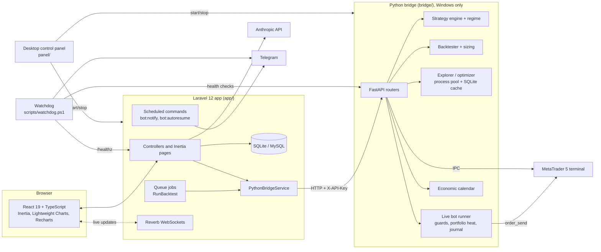

# Forex Trading System

A platform for designing, backtesting, validating and running algorithmic forex strategies on MetaTrader 5. It pairs a Laravel + React web app with a Python FastAPI bridge to the MT5 terminal.

> **Disclaimer:** This is a personal research project. It is not financial advice, and nothing in this repository says any strategy is profitable. Trading foreign exchange and other leveraged instruments carries a high risk of loss. Use a demo account.

## What it does

Most retail strategy work happens in disconnected tools: a charting app, a spreadsheet, a backtester and a broker terminal. This project puts the whole loop in one system, from strategy to backtest, analysis, adjustment, out-of-sample validation and live (demo) execution, with every result stored in a database.

- **Strategy engine.** 15 parameterised strategy types (MA cross, RSI, MACD, Bollinger, combined, Supertrend, Ichimoku, Donchian, Stochastic, CCI, Parabolic SAR, time-series momentum with and without a volatility filter, IBS, Connors RSI-2). Strategies are versioned in the database.
- **Event-driven backtester.** Written in pandas. It models costs, fixed or ATR-based stop-loss, and risk-percent position sizing, and reports metrics such as win rate, profit factor, Sharpe, Sortino, max drawdown and streaks.
- **Strategy Explorer.** Runs a parallel grid search over pairs, timeframes, strategy types and parameters. Results are cached in SQLite and ranked by a priority score. The top N are then re-checked with walk-forward validation.
- **Optimizer.** Uses an in-sample / out-of-sample split and a neighbour-robustness check to flag fragile parameter sets.
- **Market regime classifier.** Combines ADX, efficiency ratio, MA200 and ATR to label each period as trend, range or volatile. The label gives context only and does not drive trades.
- **Historical bot.** Simulates favourite strategies forward from a cut-off date and compares the result with what the backtest promised.
- **AI analysis.** Sends backtest context to the Anthropic Messages API, or builds a copy-paste prompt for a no-cost manual mode. The system validates the suggested parameters before it creates a new strategy version.
- **Live bot (demo).** Runs a portfolio of strategies through MT5 with per-strategy daily loss limits, maximum positions, circuit breakers, a portfolio heat limit and an economic calendar news filter. Every open and close is logged to a journal.
- **Operations tooling.** Telegram notifications, a Windows watchdog with debounce, a `/healthz` endpoint, safe auto-resume after a reboot, and a desktop control panel that starts and stops all services.

## Architecture



- **`bridge/`** is the market layer. The official `MetaTrader5` Python package only works on Windows, so this layer runs next to the terminal. It exposes account, market data, order execution and a price stream over REST and WebSocket, plus the CPU-heavy work: backtests, Explorer sweeps, optimization and the live bot loop. It binds to localhost only and needs an `X-API-Key` header on every data and trading endpoint.
- **`app/`** is the application layer. It stores strategies, backtests, trades, favourites, AI analyses and bot runs. It orchestrates the bridge through `PythonBridgeService`, pushes live updates through Reverb, and serves the React SPA. The service can also target a second, separate bridge for a crypto market. That bridge is not part of this repository.
- **`panel/`** is a Tkinter desktop tool, in the style of the XAMPP control panel. It starts, stops and restarts the bridge, Laravel, Reverb and the queue worker, and shows MT5 and Algo Trading status.
- **`scripts/watchdog.ps1`** is meant to run as a scheduled task. It checks the bridge, the MT5 connection and Laravel database writes, alerts through Telegram after consecutive failures, and pings a dead-man's-switch URL.

## Tech stack

| Layer | Technologies |
|---|---|
| Market bridge | Python, FastAPI, Uvicorn, Pydantic, pandas, NumPy, MetaTrader5, httpx |
| Backend | PHP 8.2+, Laravel 12, Laravel Reverb, queues, scheduler, Anthropic PHP SDK |
| Frontend | React 19, TypeScript, Inertia.js, Tailwind CSS v4, TradingView Lightweight Charts v5, Recharts, Vite |
| Data | SQLite (local), MySQL (production), SQLite cache for the Explorer |
| Ops | Tkinter + psutil desktop panel, PowerShell watchdog, Telegram Bot API |
| Testing | pytest, PHPUnit, Vitest |

## Results

This repository contains no performance claims. The verifiable figures are the automated test suites, which I ran locally without an MT5 terminal or network access:

| Suite | Result |
|---|---|
| Python bridge (`bridge/tests`, pytest, 22 files) | 148 passed |
| Laravel (`app/tests`, PHPUnit) | 86 passed, 376 assertions |
| Frontend (`app/resources/js`, Vitest) | 8 passed |

The bridge suite needs `BRIDGE_API_KEY` set in the environment. The Laravel suite needs the frontend built (`npm run build`), because page tests render the Vite manifest.

## Running locally

### Requirements

- Windows 10/11 for the bridge, with a MetaTrader 5 terminal installed and logged in to a **demo** account
- Python 3.11 or 3.12
- PHP 8.2+ with `pdo_sqlite`, `mbstring`, `openssl`, `curl`, `fileinfo`, `zip`
- Composer 2, Node 18+ and npm

### 1. Python bridge

```bash
cd bridge
python -m venv .venv
.venv/Scripts/python.exe -m pip install -r requirements.txt httpx pytest
cp .env.example .env
```

Set the following in `bridge/.env`:

```env
MT5_LOGIN=<your_demo_login>
MT5_PASSWORD=<your_demo_password>
MT5_SERVER=<your_broker_demo_server>
MT5_PATH=
BRIDGE_API_KEY=<long_random_key>
BRIDGE_HOST=127.0.0.1
BRIDGE_PORT=8000
```

```bash
.venv/Scripts/python.exe run.py            # http://127.0.0.1:8000/docs
BRIDGE_API_KEY=test .venv/Scripts/python.exe -m pytest -q
```

The bridge starts even when MT5 is closed. It connects to the terminal lazily, on the first market request.

### 2. Laravel app

```bash
cd app
composer install
npm install
cp .env.example .env
php artisan key:generate
# edit app/.env first (see below): the seeder needs ADMIN_EMAIL and ADMIN_PASSWORD
php artisan migrate --seed
npm run build
```

Set the following in `app/.env`:

```env
ADMIN_EMAIL=<your_admin_email>
ADMIN_PASSWORD=<choose_a_strong_password>
BRIDGE_URL=http://127.0.0.1:8000
BRIDGE_API_KEY=<same_key_as_bridge>
ANTHROPIC_API_KEY=<optional>
TELEGRAM_BOT_TOKEN=<optional>
TELEGRAM_CHAT_ID=<optional>
REVERB_APP_ID=<id>
REVERB_APP_KEY=<key>
REVERB_APP_SECRET=<secret>
BROADCAST_CONNECTION=reverb
```

Run the processes, each in its own terminal:

```bash
php artisan serve --port=8090
php artisan reverb:start
php artisan queue:work
php artisan schedule:work      # bot:notify and bot:autoresume
php artisan test               # after npm run build
npm test                       # Vitest
```

### 3. Optional tooling

```bash
cd panel && pip install -r requirements.txt && python panel.py     # desktop control panel
powershell -File scripts/watchdog.ps1                             # run from Task Scheduler
```

## What I learned / key technical decisions

- **Split the system along the platform constraint.** The MT5 Python library only runs on Windows and executes real orders. So I put it in a small FastAPI bridge, bound to localhost and protected by an API key, and kept everything else in a portable Laravel app. The CPU-heavy work stays in Python, where pandas and a process pool can use every core.
- **Build my own backtester instead of using a framework.** I started with vectorbt in the plan, then wrote an event-driven pandas engine. It avoided the numba dependency on Windows and gave me full control over costs, ATR stops, risk-percent sizing and trade markers. I also wrote tests that check the live executor reproduces the backtest sizing and stops exactly, because a bot that drifts from its backtest is untrustworthy.
- **Rank by out-of-sample results, not in-sample.** The Explorer and optimizer rank configurations on unseen data, check neighbour robustness, and send the top results through walk-forward validation and a historical bot that runs forward from a cut-off date. Re-checking on a final untouched period showed me that a top-ranked result often fails to persist.
- **Layer the safety mechanisms.** Per-strategy daily loss limits and circuit breakers, portfolio heat, an economic calendar news window, fail-safe pausing on restart, and an auto-resume command that only acts when MT5 and the database are healthy and the bridge is not crash-looping. Each layer is designed to fail closed.
- **Treat observability as a feature.** A watchdog that runs outside the processes it monitors, with debouncing to avoid false alarms from slow MT5 calls. A `/healthz` endpoint that performs a real database write to catch locked SQLite files. Telegram notifications. A desktop panel, because a web page cannot start the web server it runs on.

## Author

**Washington Quevedo**

- LinkedIn: https://www.linkedin.com/in/wxquevedo
- GitHub: https://github.com/wx-quevedo
